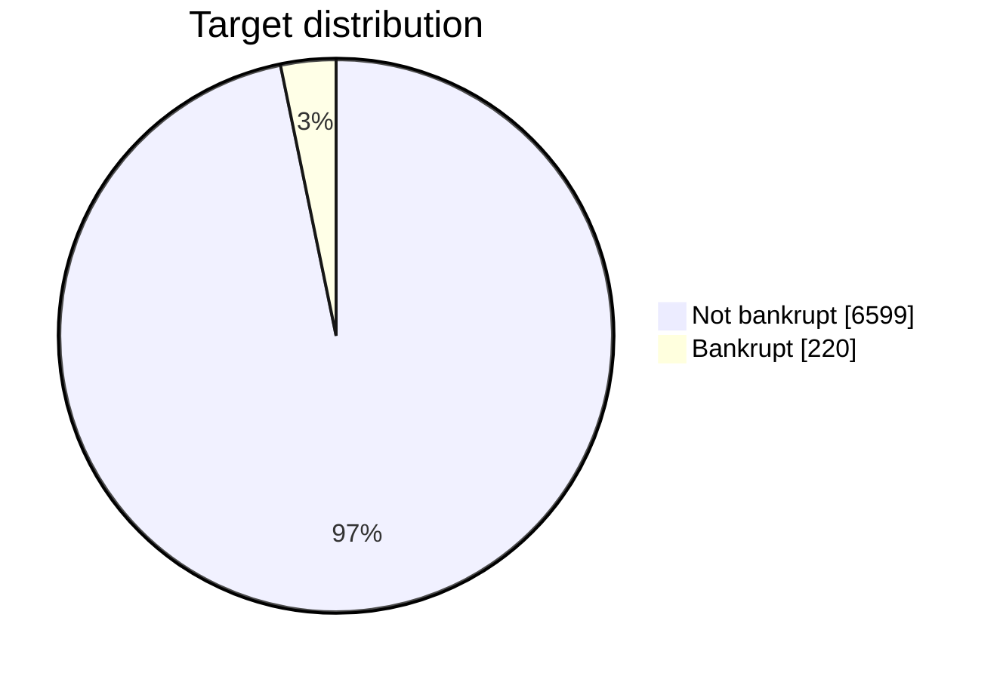
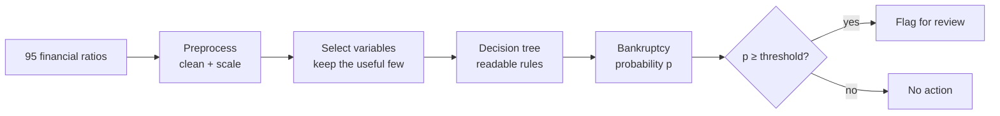
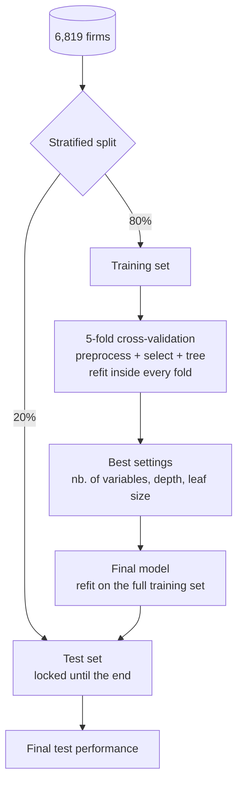

# Taiwanese Bankruptcy Prediction — Combined Approach


> **Can a handful of financial ratios and a readable decision tree tell us which firms are about to go bankrupt?**

Final project for the *Augmented Decision* course. We use **variable selection** to keep only the useful ratios, then a **decision tree** to turn them into simple rules that support a real decision.

---

## The decision

A credit analyst looks at a firm's financial ratios and decides whether to **flag it for review**.

|                     | Firm survives                      | Firm goes bankrupt                       |
| ------------------- | ---------------------------------- | ---------------------------------------- |
| **Don't flag**      | 0                                  | $C_{FN}$ — missed bankruptcy (expensive) |
| **Flag for review** | $C_{FP}$ — needless review (cheap) | 0                                        |

Missing a bankruptcy costs far more than a needless review, so we don't flag at 50%. Given the tree's estimated probability $p$, we flag when the expected loss of flagging is lower:

$$
\text{flag} \iff p \ \ge\ \frac{C_{FP}}{C_{FP} + C_{FN}}
$$

---

## The data

[Taiwanese Bankruptcy Prediction](https://doi.org/10.24432/C5004D), UCI Machine Learning Repository. Collected from the Taiwan Economic Journal, 1999–2009. See [data/README.md](data/README.md).

| Firms | Features             | Bankrupt     | Missing values |
| ----- | -------------------- | ------------ | -------------- |
| 6,819 | 95 financial ratios  | 220 (3.2%)   | none           |



> [!IMPORTANT]
> A model that always answers *"not bankrupt"* is **96.8% accurate and completely useless**. That's why we judge models by **misclassification cost**, not accuracy.

---

## The approach



1. **Preprocess.** Drop the constant column, tame extreme values (some ratios reach 10¹⁰), and scale.
2. **Select.** Keep only the ratios that carry signal, using course methods (LASSO / forward selection).
3. **Classify.** A shallow decision tree gives if-then rules and a bankruptcy probability in each leaf.
4. **Decide.** Flag the firm when its probability exceeds the cost threshold.

---

## How we evaluate



We compare the final model against two baselines:

- **Always "not bankrupt"**, the trivial majority-class rule.
- **Decision tree on all 95 ratios**, which shows what variable selection adds.

---

## Repository

```
.
├── context/
│   ├── CourseSlides/            # lecture slides
│   └── ProjectRequirements.pdf  # project brief
├── data/
│   ├── data.csv                 # the dataset
│   └── README.md                # dataset description
└── README.md
```

---

## References

- *Taiwanese Bankruptcy Prediction* [Dataset] (2020). UCI Machine Learning Repository. https://doi.org/10.24432/C5004D. CC BY 4.0.
- Liang, D., Lu, C.-C., Tsai, C.-F., & Shih, G.-A. (2016). Financial ratios and corporate governance indicators in bankruptcy prediction: A comprehensive study. *European Journal of Operational Research*, 252(2), 561–572.
